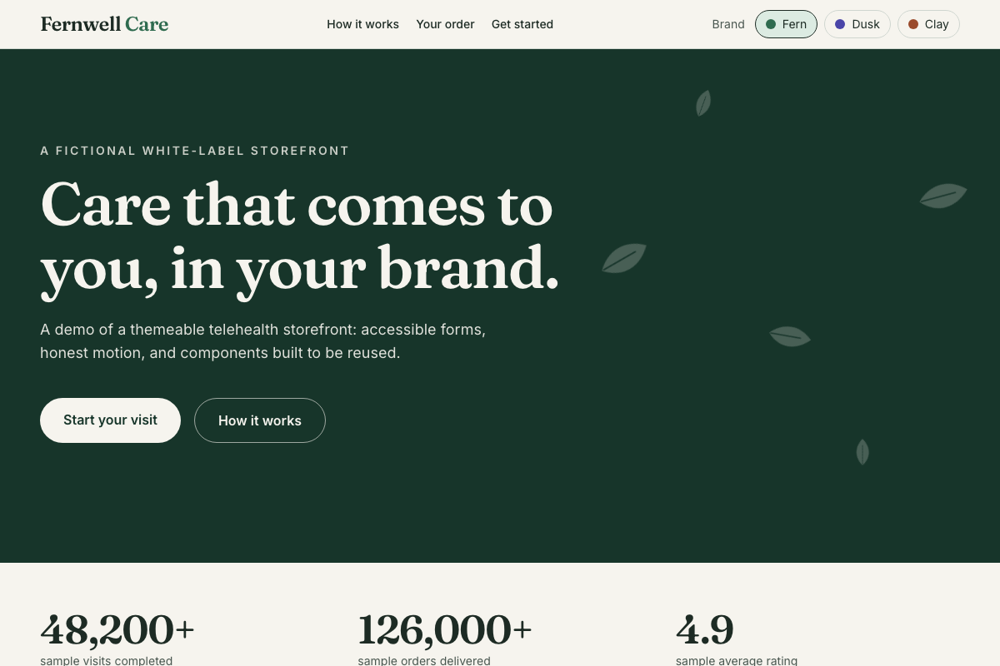

# Fernwell Care – Telehealth Storefront Demo



A small, **fictional** white-label telehealth storefront. I built it to practice and show the kind of work I enjoy: turning a design idea into a polished, accessible, well-structured web experience with purposeful motion.

> **Fernwell Care is not a real company or medical service.** All names, numbers and content are made up, the intake form collects and sends nothing, and nothing here is medical advice. It is an independent portfolio project and uses no assets from any real product.

**Live demo:** https://telehealth-storefront-demo.vercel.app/

**Stack:** Next.js (App Router) · React · TypeScript · Tailwind CSS v4 · Framer Motion

## What it demonstrates

| Feature | What to look at |
|---|---|
| **White-label theming** | The *Brand* switch re-skins the whole page. Colors live in CSS variables (`src/app/globals.css`); components only use semantic tokens like `bg-brand`, so a new brand is one block of variables. |
| **Reusable motion** | `FadeIn` (scroll reveal), `Counter` (count-up numbers) and `OrderTimeline` (scroll-driven progress) are small components with typed props, reused across the page. |
| **Looping hero motion** | Drifting leaves in pure CSS, with a visible pause control. |
| **Accessible form** | Real `fieldset`/`legend`, labels tied to inputs, a slider with a text equivalent (`aria-valuetext`), and a polite live-region message. |
| **Reduced motion** | Every animation has a `prefers-reduced-motion` path (see below). |

## Design decisions

**Motion is an enhancement, never required.** Under `prefers-reduced-motion: reduce`: reveals show content immediately, counters show their final value, the timeline renders fully complete, and the hero leaves stop and the pause control is hidden. The page works identically without motion.

**Pause, stop, hide.** The hero loop runs longer than five seconds, so it has a visible "Pause background motion" button (WCAG 2.2.2). The animation is decorative and `aria-hidden`.

**Screen readers hear the real number.** The animated counter is `aria-hidden`; a visually hidden span holds the final value, so nobody hears "1… 2… 3…" while it counts.

**Tokens, not hard-coded colors.** Each theme's text/background pairs were chosen to meet WCAG 2.1 AA contrast (4.5:1 for text). Swapping the theme can't break contrast because the pairs travel together.

**Performance by default.** Only the pieces that need interactivity are client components; the rest is statically rendered. Fonts use `next/font` (self-hosted, `display: swap`), the hero is CSS rather than a video file (no large asset to load), and animations use `transform` and `opacity` only, so they stay off the layout path (cumulative layout shift is 0).

**Semantic structure first.** Skip link, one `h1`, landmarks, a real `<ol>` for the order steps, a consistent visible focus ring, and a single mobile-friendly layout.

## Lighthouse

Run against the live Vercel deployment with Lighthouse's default mobile emulation:

| Performance | Accessibility | Best Practices | SEO |
|---|---|---|---|
| 98 | 100 | 100 | 100 |

First Contentful Paint 0.9 s · Largest Contentful Paint 2.3 s · Total Blocking Time 20 ms · Cumulative Layout Shift 0. Full report: [`docs/lighthouse-report.html`](docs/lighthouse-report.html).

Automated tools catch only part of accessibility. I verified the reduced-motion behavior using Chrome's forced reduced-motion setting. I have **not** yet done a full manual keyboard pass or a screen-reader pass, so treat the accessibility claims as "built with care and automatically checked", not "audited".

## Run it locally

Requires Node.js 20+.

```bash
npm install
npm run dev      # http://localhost:3000
```

```bash
npm run build && npm start   # production build
npm run lint
```

## Project structure

```
src/
  app/
    globals.css        # design tokens, themes, hero animation
    layout.tsx         # fonts, metadata
    page.tsx           # page sections
  components/
    FadeIn.tsx         # reusable scroll reveal
    Counter.tsx        # accessible count-up
    OrderTimeline.tsx  # scroll-driven timeline
    HeroBackground.tsx # looping background + pause control
    Questionnaire.tsx  # accessible demo form
    ThemeSwitcher.tsx  # white-label theme switch
```

## What I'd do next

- Add Playwright tests for keyboard flow and the reduced-motion paths, plus an automated axe check.
- Persist the chosen theme without a flash of the default (a tiny inline script before hydration).
- Swap the CSS hero for an optimized looping video with a poster image and the same pause control.
- Add a screen-reader pass (VoiceOver) and fix anything it turns up.

## License

MIT – see [LICENSE](LICENSE).
